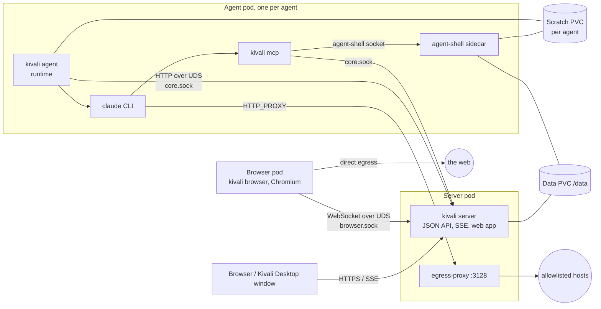
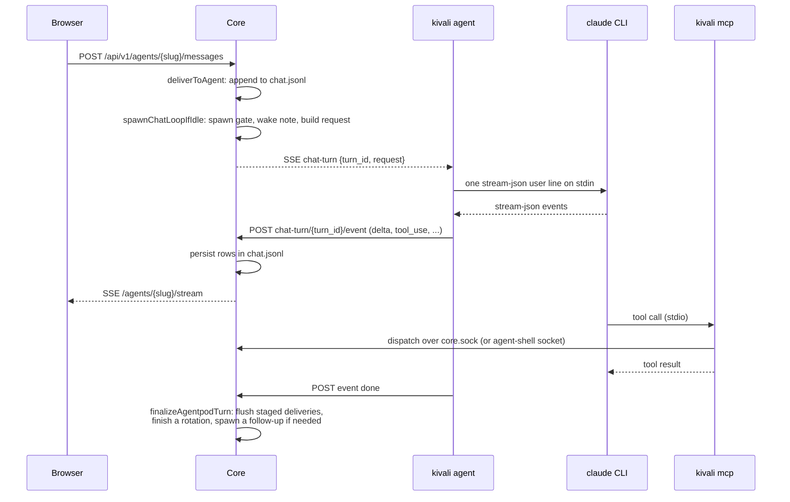

# Architecture

How the pieces of Kivali fit together: the server, the agent pods, the
model driver, storage, and how a message becomes a turn. The user-level
picture is [how-kivali-works.md](../how-kivali-works.md); this is the
developer's.

## The pieces



### The server (core)

One Go binary, `kivali` (`main.go`). With no subcommand it is the
server. It owns every durable byte and is the only writer to `/data`
(`internal/store`). It serves:

- **The web app**: the Vite build of `web/`, embedded from
  `internal/web/ui/dist` and served for every GET no other route
  claims (`internal/web/ui`).
- **The JSON API** under `/api/v1/` (`internal/web/api*.go`; wire
  types in `internal/web/apitypes`, mirrored to TypeScript by
  `make api-types`).
- **Server-Sent Events**: `/org/stream` (a snapshot-first feed of
  every agent's liveness, Home's counts and the queue;
  `internal/web/org_stream.go`), `/agents/{slug}/stream` (one agent's
  live chat events; `internal/web/chat_hub.go`) and
  `/agents/{slug}/subagents/{id}/stream` (one background task's
  transcript).
- **Auth**: Google sign-in, the allowlist and session cookies
  (`internal/auth`, [auth.md](auth.md)). `DEV_MODE` bypasses all of it
  and only binds loopback.
- **Two Unix sockets with one route table** (`internal/web/control_socket.go`,
  `registerUDSRoutes`): the control socket at
  `$DATA_DIR/.kivali-control.sock`, reachable only from inside the
  server container, and `core.sock` in the `core/` subdirectory of
  `AGENTPOD_UDS_DIR` (`/var/run/kivali/uds` in the chart), a hostPath
  directory on the server's node. A third socket, `browser.sock` in the
  `browser/` subdirectory, serves only the browser pods' connect route
  (`StartBrowserSocket`). Each kind of pod mounts its own subdirectory
  alone: an agent pod mounts `core/` and never sees `browser.sock`, a
  browser pod mounts `browser/` read-only and never sees `core.sock`,
  so neither can reach, or replace, the other's socket. Core creates
  both subdirectories (mode 0700) when it starts listening; a pod that
  found its subdirectory missing would only wedge on a socket that is
  not there, so both mount with `type: Directory`. All sockets are
  mode 0600; file permissions
  and a matching UID are the authentication. Every agent-scoped route
  is `/v1/agent/{slug}/...` and must carry `X-Kivali-Agent: <slug>`;
  the server rejects a mismatch, and overrides any `from`/parent in a
  body with that slug.

Layering inside the server: `internal/store` (files, the only
writer) → `internal/agent` (per-agent runtime: context assembly, tool
dispatch, hire/offboard) and `internal/messaging` (routing, release,
bounce) → `internal/web` (HTTP, hubs, turn orchestration). The model is
reached through `internal/provider`, a provider-neutral seam, whose one
implementation is `internal/claudeagent`.

### Agent pods

Every agent except the CEO runs in its own pod, `agentpod-<slug>`,
which the server provisions on hire and deletes on offboard
(`internal/agentpod/provisioner.go`, `manifest.go`). The pod has no
Service and no ports, no service-account token, and a required
pod-affinity to the server's node, because the hostPath socket exists
only there. It owns no authoritative state: delete it and nothing is
lost.

| Container | Image | What it does |
| --- | --- | --- |
| `prepare-scratch` (init) | `kivali` | `kivali prepare-scratch`: mounts the whole per-agent scratch PVC and creates its two halves, owned by the pod's user |
| `agent` | `kivali` | `kivali agent --slug=<slug> --uds=<dir>/core/core.sock` (`agent_cmd.go`, `internal/agentpod/runtime.go`): holds the events stream to core, drives the warm `claude` CLI and its subagent CLIs. Mounts its half of scratch at `/scratch`, the UDS dir's `core/` subdirectory, the agent-shell socket dir, and from the data PVC only the provider home (`/data/claude-home`). The only container that sees the Claude sign-in. When the CLI's sign-in changes (what `claude auth status` reports, or `settings.json`; re-checked when `.credentials.json` or `settings.json` changes), the runner registry respawns the warm CLI with `--resume` at the agent's next turn (`internal/claudeagent/signin.go`) |
| `agent-shell` | `kivali-agent-shell` | `cmd/agent-shell`, `internal/agentshell`: an HTTP-over-UDS daemon on `/run/kivali-agent-shell/sock` (an emptyDir shared with `agent`) that runs `run_shell` and every `file_*` tool. The only container that mounts the agent's `/files/`, with `HOME=/scratch/home` on its own half of scratch. Serves as 65532; with software to install it starts as root, installs it in a root child and drops before it serves ([files-and-publishing.md](files-and-publishing.md#software-in-the-agent-shell)) |

The agent-shell's `/files/` is the agent's tree on the data PVC
(`agents/<slug>/memory/`), with the core-managed subtrees
(`project/`, `skills/`, `attachments/`, `past-chats/`, `episodes/`,
`artifacts/public/`, `artifacts/shared/`) mounted read-only over it,
and the targets of its symlink farms (`/data/project_files`,
`/data/skills`, `/data/agents/<slug>/attachments`,
`/data/agents/<slug>/chats`) mounted read-only beside it. So `bash`
and `file_view` see the same bytes at the same paths, and nothing an
agent can write sits next to the Claude credentials.
[files-and-publishing.md](files-and-publishing.md) has the layout and
the publish path.

**Reconcile.** The pod manifest carries a `kivali-spec-hash` label, a
hash of the rendered spec. `Provision` leaves a pod whose label matches
and deletes and recreates one that differs, so a new server image or env change reaches every agent the next time
the server provisions. At boot the server syncs each agent's filesystem and provisions every active agent
(`BulkProvisionAgentPods`), and provisions again, after a backoff that
doubles from 5 s to a minute, the agents whose pod it could not create
and that are still active, until every pod exists or the boot's five-minute deadline passes (right
after the node boots, the API server's service address can go
unanswered for tens of seconds); hire does the same for one. Until the
boot pass has provisioned an agent's pod, its turns are held
(`HoldTurnsForStartup`), so a pod left running from before the restart
that dials in at once starts nothing the pass is about to cut short. A
software change recreates a pod only once its agent is idle, with no
turn running and no background task outstanding, and holds the agent's
turns while it does (`ReprovisionAgentPod`, `internal/web/agentpod_restart.go`);
work that arrives meanwhile stays owed and starts on the new pod. The
scratch PVC is never diffed and survives offboarding.

**The agent pod's protocol** (`internal/agentpod/protocol.go`). Core
never dials an agent; every connection goes from the pod to
`core.sock`:

- `GET /v1/agent/{slug}/events`: a long-lived SSE stream from core.
  The runtime sends `X-Kivali-Runtime`, an id it draws once per
  process; a reconnect carries the same id, and a different one means
  the earlier runtime, and any turn it was running, is gone.
  Events: `chat-turn` (drive a turn; carries the fully built model
  request), `fold-message` (splice a message into the running turn),
  `cancel-turn` (Stop), `session-reset` (a chat was archived: drop the
  warm CLI), `cache-invalidate`, `ping`. Comment heartbeats every 15 s.
- `POST /v1/agent/{slug}/chat-turn/{turn_id}/event`: every streamed
  event of a turn (deltas, thinking, tool use and results, folded,
  done, failed) goes back one POST at a time.
- Data and tool dispatch: chat history and append, role, memory,
  session id, past chats, attachments and project files (content
  addressed), skills, publish stage/commit, artifact, state and
  share-file dispatch, route-message, run-subagent and its
  status/cancel.

### The model driver

`internal/claudeagent` drives the Claude Code CLI
(`@anthropic-ai/claude-code`). Each agent has one warm runner: a
long-lived `claude -p --input-format stream-json` subprocess whose
stdin stays open across turns (`runner.go`). A turn writes one user
line; the stream-json output is translated into provider stream
events. The runner is spawned with `--resume <session-id>` when one is
stored, so a restarted pod continues the conversation. Model, effort
and system prompt are spawn-time flags: when any of them differs from
the next request the runner respawns with `--resume`, which is how an
edit to the handbook, role or memory lands on the next turn. A runner
that dies within seconds of a `--resume` spawn has its session id
cleared, so a corrupt session log cannot loop.

The CLI's tools come from `kivali mcp --agent <slug> --core-uds ...`
(`mcp_cmd.go`, `internal/mcp`), an MCP server over stdio that the CLI
starts. It dispatches `run_shell` and `file_*` to the agent-shell socket
and everything else to core over `core.sock`. The tool surface is
listed in [context-serialization.md](context-serialization.md) and the
model catalog lives in `internal/claudeagent/catalog.go`.

**Billing.** The CLI signs itself in, once, in the server container:
`kivali-supervisor terminal` runs `claude`, which shows its sign-in menu
when it is not signed in (`/login` switches): a Claude subscription, an
Anthropic Console account, Amazon Bedrock or Google Vertex AI. Microsoft
Foundry has no CLI sign-in; Kivali Desktop's form writes it through the
supervisor's `POST /v1/credential/setup` (`internal/claudeauth`,
`setups.go`), or a self-hoster writes the `env` block by hand. What the
sign-in stores lives on the data PVC in `/data/claude-home/` (the CLI's
HOME: `.claude/.credentials.json`, and `.claude/settings.json`'s `env`
block for a cloud provider), which every agent pod mounts as the CLI's
home, so the whole deployment bills one way. No credential variable reaches an agent pod, and the server
refuses to start with `ANTHROPIC_API_KEY`, `ANTHROPIC_AUTH_TOKEN` or
`CLAUDE_CODE_OAUTH_TOKEN` set. Whether it is signed in, and to what, is
the CLI's own answer: `claude auth status --json`, parsed by
`internal/claudeauth`, for the server's setup state
(`Credentials().Status`) and the supervisor's `GET /v1/credential`.
Agent pods reach Bedrock, Vertex AI and Foundry through the egress
proxy; the default allowlist carries their hosts.

The server also calls the model itself for short jobs that are not an
agent's turn: the setup briefing, inbox summaries and episode digests.
Every call appends a record to `/data/usage.jsonl`.

### The egress proxy and the fence

`cmd/egress-proxy` runs as a sidecar in the server pod on port 3128,
behind the `kivali-egress` Service. It forwards HTTP and HTTPS
(CONNECT) only to hosts on the allowlist, a file the server writes from
`/data/allowed_egress.yaml` (Org → Network) into a shared emptyDir; the
proxy hot-reloads it. Agent containers get `HTTP_PROXY`/`HTTPS_PROXY`
pointing at it. A pattern covers its name and every subdomain; one with
`*` or `[...]` after an optional leading `*.` is a per-label glob
(`path.Match` on each label, so a wildcard never crosses a dot), which
is how the defaults reach every region's Bedrock and Vertex AI endpoint
without allowing all of `amazonaws.com` or `googleapis.com`. The
defaults are written once, when a team's list does not exist yet.

The proxy alone would be advisory. The chart's NetworkPolicy
(`charts/kivali/templates/networkpolicy.yaml`) makes it binding: agent
pods may reach only port 3128 on the server pod and DNS, so a raw
socket goes nowhere, and the server's HTTP port refuses pod addresses,
because the API trusts whoever reaches it as the owner. Details in
[../../charts/kivali/README.md](../../charts/kivali/README.md).

### Around the server

In every real deployment the server runs in k3s inside a VM that
`kivali-supervisor` boots and installs the chart into; Kivali Desktop
is the app that drives the supervisor. See
[supervisor.md](supervisor.md), [../../vm/README.md](../../vm/README.md),
[desktop-app.md](desktop-app.md) and [deployment.md](deployment.md).

## Storage

There is no database. Everything durable is a plain file under
`/data`, written by `internal/store` with atomic renames:

```
/data/
  handbook.md                 the rules every agent works under, inlined into every call
  message_queue.json          each agent's queue of unreleased messages
  messages/<YYYY-MM-DD>/      the message ledger, one Markdown file per message, UTC days
  messages/.redacted/         bounced messages, kept out of the live ledger
  assignments/                the assignment tracker (assignments.md)
  graph/                      the knowledge-graph index (knowledge-graph.md)
  public/<slug>/              each agent's published files
  project_files/<sha>/        uploaded project files, content-addressed
  attachments/<sha>/          message and chat attachments, content-addressed
  skills/                     uploaded and built-in skills
  skill_settings.json         which skills are enabled
  usage.jsonl                 one record per model call: tokens and cost
  allowed_egress.yaml         the egress allowlist
  branding/                   org name, logo and derived favicons
  claude-home/                the CLI's HOME: its sign-in and settings
  agents/<slug>/              one directory per agent (below)
  agents/_archived/<slug>/    offboarded agents; nothing is deleted
```

```
/data/agents/<slug>/
  agent.yaml                  identity and settings
  role.md                     the role, written at hire
  agent_memory.md             what the agent knows; it edits this itself
  agent_memory_habits.md      learned rules of behaviour
  chat.jsonl                  the current conversation, append-only
  chats/<ts>/                 archived generations: chat.jsonl, the memory
                              snapshots, episode.md
  attachments/                hardlinks to the attachments this agent has seen
  memory/                     the agent's /files/ tree (files.StorageDirName)
    artifacts/private/        its workspace
    background/               shared with its subagents (plan.md)
    subagents/<id>/           each subagent's view
    project/ skills/ attachments/ past-chats/ episodes/   symlink farms, read-only
```

## A turn



1. Something external lands in the agent's `chat.jsonl` as a
   `received` row through `deliverToAgent` (`internal/web/chat.go`):
   the CEO typing, a released message, a subagent's result, a rotation
   prompt.
2. `spawnChatLoopIfIdle` decides whether to start a turn
   (`store.SpawnDecision`: an unanswered received row, or a disruption
   to resume from; never after a Stop until the CEO writes again;
   never for a quarantined agent with three runtime disruptions in a
   row). It appends the wake note (what changed and what the agent
   holds; [knowledge-graph.md](knowledge-graph.md)), builds the
   request with `agent.Runtime` (the layering is in
   [context-serialization.md](context-serialization.md)) and publishes
   a `chat-turn` event to the agent's pod. When no pod is subscribed
   (a fresh hire, or a restart whose pods are not back yet) nothing
   starts and the work stays owed in `chat.jsonl`; the pod's
   subscription to its events stream runs the same decision again
   and starts the turn.
3. The runtime runs it on the warm CLI and posts every event back.
   Core persists the rows and broadcasts them to the page; tool calls
   go from the CLI to `kivali mcp` and on to core or the agent-shell.
4. On `done`, `finalizeAgentpodTurn` (`internal/web/agentpod_turn.go`)
   flushes deliveries staged during the turn and, if any arrived,
   spawns the follow-up turn that reads them. A runtime that goes away
   mid-turn (its pod deleted or crashed) ends the turn as a
   `runtime-disruption`, which the agent resumes from on its next pod:
   when it reports it is shutting down (`runtime-stopped`), when a
   different runtime subscribes for the agent, or when none of its own
   is back within 30 s. A pod Kivali recreated itself makes the row
   `planned`, which the crash-loop breaker does not count. On `failed`, core writes
   a `turn-error` or `runtime-disruption` marker row; an errored agent
   holds until a new message arrives.

## Message delivery

Agents publish with `publish_notice`, `publish_ceo_approval_request`
and `publish_ceo_notification`; assignments produce `assignment_event`
messages ([assignments.md](assignments.md)). A publish is routed inside
the tool call (`internal/messaging`): the message file is written to
the ledger and routed under the queue lock, so it exists the moment it
is sent.

- **Agent to agent**: queued in the recipient's entry in
  `message_queue.json`. Nothing is delivered until the CEO **releases**
  it from the Queue on Home: one at a time (with an optional inline
  comment), all at once (*Release all*, which also wakes every active
  agent), or automatically after a delay set on the Queue's slider
  (`internal/web/auto_release.go`). A **bounce** drops every pointer,
  moves the file to `messages/.redacted/` and sends the sender a
  notice with the CEO's required comment.
- **To the CEO**: never queued. It is appended to the CEO's inbox at
  once, and the CEO's answer (approve, deny, ack, reply) is delivered
  to the sender at once. An approved proposal is applied before the
  answer is delivered.
- **Delivery** is `Messenger.DeliverToAgent`, which renders the inbox
  body and hands it to the server's `deliverToAgent`, then wakes the
  recipient. A message marked **quiet** (and a pure receipt) is
  delivered without a wake: it folds into a running turn or is read at
  the next one.

### Arriving during a turn: folds and pending messages

`deliverToAgent` has three cases:

- **Idle agent**: append to `chat.jsonl`.
- **A turn is running**: stage the message in a per-agent buffer and
  offer it to the turn as a **fold** (`fold-message`). The CLI splices
  a uuid-stamped user line into the running turn at its next tool
  round; the runtime reports whether it was taken. A message the CLI
  takes after the turn's last step is answered in a continuation the
  runtime keeps as part of the same turn. A fold the pod refuses asks
  the turn to wind up (a `cancel-turn` for the parent turn only).
  Whatever is still staged is flushed when the turn ends.
- **A rotation is running**: stage only. The message opens the new
  chat after the archive.

Staging exists because the turn is writing its own rows to
`chat.jsonl`; a received row spliced into the middle would break
append order and the tool-use/tool-result pairing. `chat.jsonl` only
ever holds what the model has.

A staged **CEO direct message** is shown on the agent page as a
**pending** message (`internal/web/chat_pending.go`): the stream sends
`pending_message`, `pending_offered`, `pending_delivered` and
`pending_deleted`, and a page that connects mid-turn seeds from the
chat endpoint. Until it has been offered as a fold, the CEO can delete
it (with a short undo window); **Send now** ends the turn early,
keeps the partial reply, writes a `paused-to-deliver` marker and
delivers every pending message under it. Pending messages live only in
memory, never in `chat.jsonl`. Other staged deliveries (releases,
subagent results) are not shown until they land.

## Subagents

An agent delegates with the `subagent` tool, up to five tasks per call
(`internal/mcp/subagent_tool.go`). Dispatch returns a receipt at once;
each task is a background job (`internal/web/subagent_service.go`,
`subagent_jobs.go`) and its result reaches the parent later as a
`subagent_result` message that wakes it. `subagent_status` and
`subagent_cancel` list and stop the parent's jobs.

Every subagent runs inside the **parent's agent pod**: core publishes a
`chat-turn` event of kind `subagent`, and the runtime starts a separate
`claude` process with its own `kivali mcp --toolkit subagent`. Its
files are a view core builds at `/files/subagents/<id>/`
(`internal/files/subagent.go`): its own `artifacts/private/`,
read-only links to the parent's project, skills, attachments and
published trees, and a writable `background/` shared with the parent
and every sibling, where `plan.md` describes the fan-out. Its tools are
the `file_*` set, `run_shell`, publishing, `list_skills` and the graph
reads.

**Structured results.** A task may carry a `schema`: a JSON Schema in
the subset `internal/structured` accepts (closed objects, arrays,
numbers, integers, booleans, enums, dates, URLs, and strings with a
required `maxLength`; the top level is an object). Core refuses any
other schema at dispatch. The subagent then also has `submit_result`,
the only way its answer reaches the caller: its final text is dropped.
Each call is `POST /v1/agent/{slug}/subagents/{id}/result`; core
validates it against the wrapper (`outcome`, `result`, `alternatives`,
`blocked_on`, `files`) and the schema, returns the errors on a refusal,
and ends the task after three refused calls, or when the run ends
without an accepted one, with `outcome: failed` and a reason core
wrote. The first accepted result is final: core ends the run a few
seconds later, and a task Stop called off delivers nothing even with
an accepted result. `files` names regular files the task made, as the
subagent sees them (`/files/artifacts/private/`, `/files/background/`),
and is delivered as the caller's paths; URLs and file names are held to
a strict character set so neither can carry prose. The wrapper JSON is
the body of the `subagent_result` message, and of a sub-lead's nested
result, in place of the run's text; `meta.json` keeps it for the task
rows.

### Web subagents and browser pods

A task dispatched with `kind: "web"` is a subagent that works in a
browser instead of a shell. It must carry a schema, names a web
session (`open`, signed in nowhere and keeping nothing between tasks,
or a site session, named by the registrable domain it is locked to,
which keeps its sign-ins), and may name a
`start_url` and `files` under the caller's `/files/` it may upload.
Its CLI runs in the parent's agent pod like any subagent, with
`kivali mcp --toolkit web`: the `web_*` tools (`internal/mcp/web_tools.go`)
and `submit_result`, and nothing else. Each `web_*` call is
`POST /v1/agent/{slug}/subagents/{id}/web` to core, which checks that
the id is the agent's running web task and that the command is one
its session allows (`web_eval` in `open` only), hands an upload's bytes
to the pod first, and relays the command under the task's tab group.
The pod's answer, text and an optional image, is the tool result.

The browser is a **browser pod** (`internal/browserpod`), one per
running (agent, session), run from the `kivali-browser` image
(`Dockerfile.browser`: Debian's Chromium, fonts for the everyday
scripts, Xvfb and the `kivali` binary; about 670 MB unpacked). It has no Service, no ports, no service-account token and no
volumes beyond a memory-backed `/dev/shm` and an emptyDir `/tmp`; it is
`restartPolicy: Never` with a 60 s stop grace, runs as the image's user
with every capability dropped, and has the same required affinity to
the server's node as agent pods, because it dials a hostPath socket:
`browser.sock`, core's socket for browser pods, in a subdirectory of
the UDS dir that is the only part of it the pod mounts, read-only. That
socket serves the pod's connect route and nothing else, so a pod that
is taken over by a page has no path to the agent routes on `core.sock`.
`kivali browser` opens one WebSocket,
`GET /v1/browser/{slug}/{session}/connect`, presenting the per-pod token
core put in its environment, and that connection carries everything
(`browserpod/protocol.go`): core's commands and the pod's results, tab
and navigation events, the pod's state, downloads on their way to core,
and the packed Chromium profile in both directions, as binary frames
announced by a message. Chromium runs with `--remote-debugging-pipe`
and `--password-store=basic`; the pod drives it over CDP, keeps a tab
group per web subagent so concurrent tasks sharing a session cannot
see each other's tabs (in `open`, each group is a browser context of
its own, with its own cookies, storage and cache, disposed with the
group; core never asks an `open` browser for its profile and stores
none), strips hidden content from snapshots in the
page's isolated world, captures downloads, and packs the profile
without its caches.

Core owns the lifecycle (`internal/web/browser_registry.go`, one timer
on the injected clock re-armed to the earliest deadline, as auto
release does). A web subagent's first command starts the pod and waits
for it to connect; the handshake hands over the session's saved
profile; when no subagent uses the browser it is idle, and after ten
minutes core asks for the profile back, writes it to the store and
deletes the pod. A browser that has run for two hours
(`browserLifetime`) takes no new task and is saved as soon as its last
task ends, never under a task or a window, so Chromium's memory does
not grow without bound. A start that does not connect within five minutes
fails the command; a lost connection fails the commands in flight and
deletes the pod; the next use starts afresh from the saved profile.
At most `BROWSER_MAX_PER_TEAM` browsers (3) run at once; a start
beyond that begins the save of the longest-idle browser, if there is
one, and is refused with a retry. A browser whose pod is being deleted
still counts until the delete returns, so a new pod under the same
name cannot be caught by the old delete. On boot core deletes every
browser pod it finds. Profiles and session records live in
`/data/agents/<slug>/browser/<session>/` (`store/browser.go`), outside
the agent's `memory/` tree, so no agent container mounts them.

Nothing the pod sends is trusted on its own. A download must name a tab
group core opened on that browser, fit the size it announced and the
task's bounds (20 files, 200 MB); it is written to the task's
`untrusted-downloads/` ([files-and-publishing.md](files-and-publishing.md))
and listed in its result's `files`. A profile is taken only while core
asked for one, up to 2 GiB; a cookie snapshot only from a site
session's running browser, up to 8 MB. Every write to the pod has a time limit,
and a pod that stops reading is dropped rather than waited on. A file
a task uploads is read through the caller's files backend with
`file_view`'s confinement, so a link out of the caller's tree is no
file, and may be up to 50 MB. The delivered result also carries the
session, the last page's origin, the duration and the pages loaded.

Browser pods browse the web for the subagent and are not held to the
egress allowlist: they reach the web directly, like any pod, with no
proxy. The chart's network policy for them allows DNS and the public
internet and excepts the pod network, the node's and cloud metadata's
link-local range and every private range, so a page cannot reach the
server pod, the cluster or the node through the browser.

### The browser window

A person watches a running web task's browser from its view: Open
browser (offered once the task has started; a queued task has no
browser yet) opens `agents/{slug}/subagents/{id}/browser`, a page with no
app chrome (in the web app a named window, so a second click focuses
the first; in Kivali Desktop a window of its own, see
[desktop-app.md](desktop-app.md)). The page holds one WebSocket,
`GET /api/v1/agents/{slug}/subagents/{id}/browser`
(`internal/web/browser_window.go`), under the session cookie like every
API route. Text messages are `apitypes.BrowserWindowEvent`: the
browser's state, the tab the window shows (sent when the window
attaches, when the task moves to another tab and when that tab's URL
or title changes) and an end with its reason, after which the page
stops; a state event also says whether the window takes input and
names the session's site. Binary messages are frames, one JPEG each.
The page sends `apitypes.BrowserWindowInput` (mouse, key and paste
events in the frame's pixels); core forwards them to the shown tab only
while the task waits for a person in a site session and drops them
otherwise, so a window is watch only unless the task asked for the
person.

The page reopens a socket that closed without an end event, waiting
1, 2, 4 and then 10 seconds between tries (`RECONNECT_MS`); while the
last state event said the window takes input the wait is capped at
4 seconds (`INPUT_RECONNECT_MAX_MS`), well inside the window grace
below, so a brief outage in the middle of a sign-in does not resume
the task. Five connects in a row that never opened (core refusing the
socket, or the task's header unreadable) end the page with a note to
reopen it from the task's page (`MAX_FAILED_CONNECTS`): the task is
not where the page was told it is, as after a core restart. Keys are
typed into a hidden editable the page focuses on a press, so an input
method or a dead key (Option+e, then e) can compose there; a key goes
to the page as itself, and composed or otherwise inserted text goes as
a paste once committed.

The path is built for several open windows at once. The pod sends a
frame as bytes after a short message, never base64 or JSON, and core
passes those bytes through untouched. Core asks the pod to screencast
the task's tab group, not a tab, and the pod moves the cast as the
group's current tab changes. Each window has a latest-frame slot in
the registry: a window that falls behind sees the newest frame when it
next reads, never a backlog, and never slows the pod or another window;
one that cannot take a write in five seconds is dropped. The page
decodes with `createImageBitmap` and paints a canvas at most once per
animation frame, outside React. The screencast is JPEG at quality 50,
at most 1280 by 800: responsiveness over colour.

The first window on a task turns its group's screencast on and counts
as a window on the browser, which keeps the browser from going idle.
The screencast stays on for ten seconds after the last window has gone,
so a reload or a brief disconnect costs nothing, then goes off. A
window on a task whose browser is not running starts one. When the
task ends, or its browser stops, every window on it is ended with the
reason. The task's view learns the browser's state (`starting`,
`running`, `stopped`, in `SubagentMeta.browser`) through its own
stream: the registry reports each change and the task's meta.json
carries it. A state event may carry a note (`reason`) the page shows
in place of its own caption, and says whether Chromium runs without
its sandbox (`sandbox_off`): the registry records the pod's
`sandbox: off` detail on its running state, and the window and the
task's view (`SubagentMeta.browser_sandbox_off`) each show a caption
saying so.

### Site sessions and sign-in

A web task's `session` is `open` or a site. A site is given as a domain
and kept as its registrable domain (`webSessionSite`, on the public
suffix list: `shop.vendor.com` is the session `vendor.com`); an
address, a bare suffix such as `co.uk`, or anything with a scheme, a
port or a path is refused at dispatch. The session's browser is told
the site in its hello and runs headed under Xvfb (some sites refuse a
headless browser's sign-in); the pod refuses `web_navigate` off the
site and its subdomains with `off_site`, `web_eval` does not exist
there, and the profile is saved and restored across browsers, so
sign-ins persist. Between saves the pod sends core the session's
cookies whenever they have changed, every five minutes and right
after a window closes (`TypeCookies`; core asks with `TypeSnapshot`),
as the array `Storage.setCookies` takes; core keeps the latest beside
the profile (`cookies.json`) and hands it to the next browser after
the profile, which sets the cookies before it reports running. A
browser that dies before its save loses minutes of cookies, not a
sign-in; a saved profile replaces the snapshot. The session record,
profile and snapshot live beside the open session's under
`/data/agents/<slug>/browser/<site>/`.

A task in a site session that an agent dispatched itself (depth 1) has
`web_wait_for_sign_in(reason)`: `sign_in`, `mfa`, `captcha` or
`consent`. Core answers it without the pod (`subagent_signin.go`): the
job becomes `waiting_for_sign_in` with the reason, the run is ended
after a short grace so the tool's answer reaches the model, the task's
slot in the pod is given back, and the windows on the task are told
they take input. Home derives a `web_sign_in` need from the state
(`webSignInItem`, every word core's) and the task's view and chip show
it; `subagent_status` lists it under its own heading. When the task's
last window has been gone for the window grace the task resumes: a new
run of the same CLI session (`SubagentSpec.Resume`, the id the first
run reported in `TurnEvent.SessionID`; `provider.SubagentRequest.Resume`
becomes `--resume`) with one line from core as its message, its tabs
as the task left them. After 24 hours with nobody coming core writes
the result itself, `blocked` with `user_did_not_respond`, and the task
ends like any other. The calling agent hears nothing until the final
result. A task in the open session, or one a subagent dispatched, has
no wait tool: a sign-in wall ends it `blocked`, `login_required`, and
the agent decides whether to dispatch again with a site session.

The calling agent sees its sessions through `subagent_web_sessions`
(names, sites, last use, whether a browser runs and how many tasks are
on each) and forgets one with `subagent_web_session_reset`, which
cancels the session's tasks, ends its browser without saving and
deletes its record and profile (`web_sessions.go`, over
`POST /v1/agent/{slug}/web/sessions` and `/web/sessions/reset`). Agent-
facing text says a web task is expensive and a sign-in very expensive,
because it costs a person's time.

Depth is capped at two tiers (`agentpod.MaxSubagentDepth`): a
first-tier subagent may act as a sub-lead and dispatch up to three
workers, which blocks it until they finish; workers cannot delegate.
Admission bounds cost (`internal/web/subagent_admission.go`): at most
six subagent CLIs per pod, of which at most four are first-tier, so a
worker can always be admitted and blocked sub-leads cannot deadlock the
pod. The pod's 4 GiB memory limit is sized for that ceiling. Stop on
the parent cancels its subagents.

## Chat rotation

**New chat** (`internal/web/handoff.go`) is how an agent's context is
reset without losing what it learned:

1. Core snapshots `agent_memory.md` and the habits file, mints the
   archive timestamp, delivers a rotation prompt asking the agent to
   reconcile its memory, writes a `pending_rotation` marker to disk and
   starts the turn.
2. The agent edits its memory with the `agent_memory_*` tools.
3. When that turn ends, `finalizeRotation` archives `chat.jsonl` and
   the snapshots to `chats/<ts>/`, clears the CLI session id, sends
   `session-reset` so the pod drops its warm CLI, removes the marker,
   and only then flushes the deliveries staged during the turn, so
   they open the fresh chat.

The marker survives a restart: a recovered turn finishes the rotation.
Off the critical path, the episode writer
(`internal/web/episode_writer.go`) digests the archived chat into
`chats/<ts>/episode.md`, which the agent reads at
`/files/episodes/<ts>.md`. The memory contract is in
[context-serialization.md](context-serialization.md).

## Running without pods

Outside Kubernetes the provisioner finds no service account and is a
no-op (`agentpod: disabled (not running in-cluster)` at boot). Chat,
messaging and release still work as long as something dials
`core.sock`. `make run` does exactly that: it seeds a data directory
with `cmd/devseed`, starts the server with `DEV_MODE=true` and
`AGENTPOD_UDS_DIR` set, and starts one `kivali-e2e agent --slug <slug>
--uds <dir>/core.sock --scratch <dir>` per agent on the host. With
`CLAUDE=fake` (the default) `cmd/fake-claude` stands in for the CLI.
There is no agent-shell; with `KIVALI_MCP_LOCAL_FILES=1` and
`KIVALI_MCP_LOCAL_FILES_ROOT` set (`make run` and the e2e suite set
both), `kivali mcp` runs `run_shell` and the `file_*` tools in-process
against that local tree ([../../web/e2e/README.md](../../web/e2e/README.md)).
